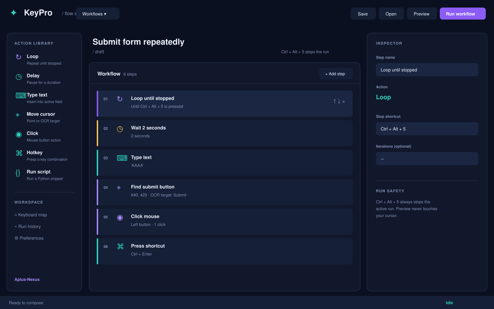

# KeyPro

> Visual workflows for the keyboard, cursor, and the tiny repetitive things.

KeyPro is a small cross-platform desktop studio for composing repeatable workflows on macOS and Windows. Build a flow from readable steps, preview it safely, then run it with a global stop shortcut. The project is designed for the **Aplus-Nexus** universe: dark ink surfaces, electric violet structure, and a cyan signal for motion.

KeyPro 是一个面向 macOS 与 Windows 的轻量工作流编排器。你可以把循环、延迟、输入文字、移动鼠标、OCR 尝试点击、鼠标点击、组合键和 Python 脚本拼成可保存、可预览、可重复运行的流程。



> This is a rendered view of the actual KeyPro editor layout using the bundled sample workflow. The same six steps are available as a portable file in [`examples/submit-form.kpflow`](examples/submit-form.kpflow).

## What it can do

- **Loop** a sequence until `Ctrl + Alt + 5` is pressed.
- **Delay** for a precise number of seconds.
- **Type text** into the active field.
- **Move the cursor** to a screen point, with an OCR target field ready for optional recognition.
- **Click** left, right, or middle mouse buttons.
- **Press hotkeys**, including combinations such as `Ctrl + Enter`.
- **Run Python snippets** for small custom actions.
- **Save and open** portable `.kpflow` workflow files.
- **Preview** a flow without touching the keyboard or mouse.

## Quick start

### From source

Python 3.9+ and PySide6 are enough to open the editor:

```bash
cd KeyPro
python3 -m pip install -r requirements.txt
python3 app.py
```

Optional integrations enable real input control and OCR. Install them with:

```bash
python3 -m pip install -r requirements.txt
```

Without optional integrations, KeyPro remains useful as a workflow editor and preview runner. The runner reports what each step would do rather than silently failing.

### From a release

Download the latest archive from [Releases](https://github.com/Aplus-Nexus/KeyPro/releases):

- **macOS:** open `KeyPro.app` from the extracted folder. If macOS asks for permission to control your computer, grant it in **System Settings → Privacy & Security → Accessibility**.
- **Windows:** extract the archive and open `KeyPro.exe`. If Windows Defender shows a first-run prompt, choose **More info → Run anyway** for an unsigned community build.

## Compose a workflow

The center canvas is deliberately simple: click a card in **Action library** to add it, select a step to edit it in the inspector, and use the arrows to reorder it. A common first flow looks like this:

Use **Workflows ▾** in the top-left to create, switch, duplicate, rename, or delete workflows. Each workflow keeps its own ordered steps while the same editor and runner stay in place.

```text
Loop until Ctrl + Alt + 5
  Delay       2 seconds
  Type text   AAAA
  Move cursor 640, 420
  Click       left button
  Hotkey      Ctrl + Enter
```

The workflow file is ordinary JSON with a `.kpflow` extension, so it is easy to version, review, or generate from another tool. A minimal example:

For a ready-to-open sample, see [`examples/README.md`](examples/README.md) and [`examples/submit-form.kpflow`](examples/submit-form.kpflow).

```json
{
  "name": "Submit form repeatedly",
  "version": 1,
  "steps": [
    {"type": "loop", "label": "Loop until stopped", "stop_hotkey": "Ctrl + Alt + 5"},
    {"type": "delay", "label": "Wait 2 seconds", "seconds": 2},
    {"type": "type", "label": "Type text", "text": "AAAA", "paste": true},
    {"type": "move", "label": "Move cursor", "x": 640, "y": 420, "ocr": true},
    {"type": "click", "label": "Click mouse", "button": "left", "clicks": 1},
    {"type": "hotkey", "label": "Press shortcut", "keys": ["Ctrl", "Enter"]}
  ]
}
```

## Safety and permissions

KeyPro has a **Preview** action and a visible stop shortcut. Preview never calls the input libraries. Live input is opt-in through the run button, and the app only uses optional integrations when they are installed and permitted by the operating system.

OCR is intentionally a best-effort path: when a target cannot be recognized, coordinate values remain the reliable fallback. Tesseract must be installed separately if you want OCR on a packaged build.

## Build locally

PyInstaller packages the same code into a windowed app:

```bash
python3 -m pip install -r requirements.txt
python3 build.py --target mac       # macOS .app in dist/
python3 build.py --target windows   # run on Windows for .exe
```

The included GitHub Actions workflow builds macOS and Windows artifacts on a `v*.*.*` tag and attaches both zip files to a GitHub Release. Cross-compiling a native desktop bundle is not reliable, so each target is built on its matching GitHub-hosted runner.

## Project shape

```text
app.py              PySide6 desktop entry point
app_qt.py           Qt editor and inspector UI
app_tk.py           dependency-light legacy Tk fallback
workflow_engine.py  workflow model, runner, stop listener, optional input adapters
build.py            PyInstaller packaging helper
assets/             KeyPro mark and repository visuals
.github/workflows/  multi-platform release pipeline
```

## License

MIT © Aplus-Nexus
